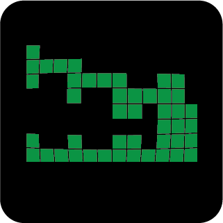

<!-- README.md is generated from README.Rmd. Please edit that file -->

```{r, include = FALSE}
knitr::opts_chunk$set(
  collapse = TRUE,
  comment = "#>",
  fig.path = "man/figures/README-",
  out.width = "100%",
  fig.width = 7,
  fig.height = 5.5,
  dpi = 120,
  message = FALSE
)
```

# rcaiman 

<!-- badges: start -->
<!-- badges: end -->

`rcaiman` is an R toolbox for preprocessing and analysis of canopy photographs.
It provides tools to represent image geometry and acquisition orientation,
correct radiometric response, reproject images, and work with point annotations.
Image enhancement and basic and advanced binarization support sky-canopy
classification. Sky-radiance modeling and interpolation support the estimation
of canopy transmittance under variable illumination.


## The rcaiman suite

`rcaiman` is the core toolbox of the suite and can be used independently of its
other components:

- [rcaiman.registry](https://github.com/GastonMauroDiaz/rcaiman.registry)
  provides calibration helpers and manages equipment specifications.
- [rcaiman.registry.data](https://github.com/GastonMauroDiaz/rcaiman.registry.data)
  distributes calibration records for reuse.
- [rcaiman-projects](https://github.com/GastonMauroDiaz/rcaiman-projects)
  provides RAW sensor-data extraction and a graphical workbench for projects,
  manual inputs, provenance, and reusable workflow templates.

## Development status and installation

This repository contains the development version of rcaiman v3. It is not yet
available on CRAN. We plan to submit v3 after a period of testing by
collaborators.

The previous CRAN release was [archived on June 9, 2026](https://CRAN.R-project.org/package=rcaiman)
because it depended on the archived `lidR` package. Version 3 no longer depends
on `lidR`: the relevant computations are now implemented in C++ within rcaiman.

You can install v3 from GitHub with:

``` r
# install.packages("devtools")
devtools::install_github("GastonMauroDiaz/rcaiman")
```

## Interface stability from v3

Version 3 introduces a deliberate break with earlier interfaces. From the v3
release onward, established public interfaces remain compatible within each
major version. Replacements will be announced with an alternative and a
deprecation period before removal in a later major release.

Public interfaces are stable unless marked otherwise. Stability is a
commitment to interface compatibility; implementations can continue to improve.

Functions and model options marked experimental may change without a
deprecation period.
Lifecycle labels describe interface stability; scientific assumptions and
limitations are explained in each function's help. Changes are recorded in
[NEWS.md](NEWS.md).

The documentation supports researchers working directly in R or with assistance
from language models. Use the documentation for the installed version when
preparing scripts.


## From sensor data to canopy openness

This example uses a Nikon Coolpix 5700 with an FC-E9 fisheye converter. The
package includes sensor data extracted from a RAW photograph, acquisition
metadata, and a snapshot of the equipment's calibration records. The example
TIFF has been reduced to 8-bit to keep the package small.

We use `rcaiman.registry` to retrieve those records. Install its development
version before running the example:

``` r
devtools::install_github("GastonMauroDiaz/rcaiman.registry")
```

### Read the image and its specifications

```{r example-input}
library(rcaiman.registry)

img_file <- system.file("external/DSCN4248.tif", package = "rcaiman")
metadata <- read.delim(sub("\\.tif$", ".tsv", img_file))
sensor_data <- read_caim(img_file)

path <- system.file(
  "external/Nikon_Coolpix5700.FCE9_raw.yaml", package = "rcaiman"
)
my_entry <- read_registry_snapshot(path)
raw <- get_signature(my_entry, "raw")
cygm <- get_band_spec(raw, "cygm")
raw_geometry <- get_geometry_spec(cygm, "simple_method")
raw_radiometry <- get_radiometry_spec(raw_geometry, "photometric_sphere")
```

### Describe geometry on the original image grid

`g` describes directions relative to the optical axis; `d` expresses them
relative to zenith and north. Here, the default orientation represents an
upward-looking acquisition with the top of the sensor toward north. The weights
in `w` account for differences in the solid angle represented by each pixel.

```{r example-geometry}
g <- set_internal_geometry(raw$dim, raw_geometry)
d <- direction_image(g)
w <- area_weight_image(g, raw_geometry)
m <- !is.na(g$off_axis)
```

### Separate the bands and correct their spatial response

This camera has a CYGM color filter array. Splitting it produces four bands
on the grid described by `g`. We use Cyan and select its flat-field calibration
by aperture. The fitted surface describes relative instrumental response;
dividing by it corrects the image before any reprojection.

```{r example-flat-field}
caim <- split_cfa(sensor_data, cfa_pattern = cygm$cfa_pattern)
names(caim)

aperture <- as.character(metadata$aperture)
ff <- trend_surface_image(
  caim$Cyan, raw_radiometry$parameters[[aperture]]$Cyan, m = m
)
r <- apply_flat_field(caim$Cyan, ff)
plot(r, col = gray.colors(256, start = 0, end = 1),
     axes = FALSE, legend = FALSE, main = "Flat-field corrected Cyan band")
```

### Classify sky and vegetation

Becker's segmentation partitions the sky into equal-solid-angle cells.
IsoData estimates a threshold within each observed segment, using `w` to
account for pixel solid angles. White pixels in the resulting binary image
represent canopy gaps.

```{r example-classification, fig.show='hold', out.width='49%', fig.width=5, fig.height=4.5}
seg <- beckers_segmentation(d, 20)
bin <- binarize_by_region(r, seg, method = "thr_isodata", w = w)

plot(seg, axes = FALSE, legend = FALSE, main = "Sky segments")
plot(bin, col = c("black", "white"), axes = FALSE, legend = FALSE,
     main = "Regional IsoData with solid-angle weights")
```

### Calculate canopy openness

Openness is the solid-angle-weighted proportion of gaps in the selected
observed region. We can use the available upper hemisphere or restrict the
calculation to zenith angles up to 70 degrees. These calculations use the
original grid and calibrated geometry.

```{r example-openness}
compute_canopy_openness(bin, d, w)
compute_canopy_openness(bin, d, w, m = m & d$zenith <= 70)
```

## Prepare an image for other software

Cropping and reprojection serve different purposes. Cropping changes the
frame while preserving pixel values and the lens projection. Reprojection
resamples the image onto a chosen projection and grid.

### Crop around the calibrated circle

For this upward-looking acquisition, the radial model gives the radius at
90 degrees from the optical axis. We use it to frame the circle in a square.

```{r example-crop}
crop_radius <- calc_relative_radius(90, raw_geometry$parameters)
crop_radius <- round(crop_radius * raw_geometry$normalization_radius)
side <- 2 * crop_radius
upper_left_indices <- raw_geometry$center_of_vision - crop_radius + 1
cropped_bin <- crop_caim(bin, upper_left_indices, side, side)
```

### Reproject to an equidistant hemisphere

Alternatively, define an 800-by-800 equidistant destination with zenith at
the center and north at the top. Reprojection interpolates the binary values;
thresholding at 0.5 restores a logical image. We keep the interpolated raster
as well, because its missing values identify the destination pixels without
interpolated data.

```{r example-reprojection}
side <- 800
target_geometry <- list(
  model = "radial_projection",
  center_of_vision = c(side, side) / 2,
  parameters = equidistant_coef,
  normalization_radius = side / 2,
  normalization_angle = 90
)
reprojected_bin <- reproject_image(
  as.numeric(bin), d, c(side, side), target_geometry, parallel = FALSE
)
bin_equi <- binarize_with_thr(reprojected_bin, 0.5)
```

```{r example-export-comparison, echo=FALSE, fig.show='hold', out.width='49%', fig.width=5, fig.height=5}
plot(cropped_bin, col = c("black", "white"), axes = FALSE, legend = FALSE,
     main = "Cropped: original lens projection")
plot(bin_equi, col = c("black", "white"), axes = FALSE, legend = FALSE,
     main = "Reprojected: equidistant")
```

### Continue in hemispheR

The standardized image can be passed to
[hemispheR](https://cran.r-project.org/web/packages/hemispheR/refman/hemispheR.html)
for gap-fraction and canopy-attribute calculations. Install it separately with
`install.packages("hemispheR")`.

`rcaiman` binary images contain no missing values. For this transfer, use `reprojected_bin` 
 hemispheR uses the `NA` pixels outside the circle to infer its radius.
Use `lens = "equidistant"` because that is the destination projection, even
though the original photograph was acquired with an FC-E9 lens.

```{r example-hemispher}
library(hemispheR)
gf <- gapfrac_fisheye(
  reprojected_bin, 
  maxVZA = 90, 
  lens = "equidistant",
  startVZA = 0, 
  endVZA = 70, 
  nrings = 7, 
  nseg = 8,
  message = FALSE, 
  display = TRUE
)
canopy_fisheye(gf)
```

With hemispheR 1.1.8, these calls report that image metadata are unavailable.
That message refers to hemispheR's metadata tags; the geometry for this example
is supplied by the standardized image and the explicit arguments above.


## Related software

[hemispheR](https://CRAN.R-project.org/package=hemispheR), by Francesco Chianucci
and Martin Macek, is an R package for processing hemispherical canopy images
and estimating canopy attributes.

[CIMES](http://jmnw.free.fr/), developed by Jean-Michel Walter, provides programs
for estimating canopy structure and solar radiation from hemispherical
photographs. Jean-Michel was an early mentor to the author of rcaiman, and the
solid-angle weighting formulation in CIMES informed rcaiman's canopy-openness
calculations. Documentation and download links are also available from
[The Gonsamo Group](https://remotesensing-mcmaster.org/data/).
